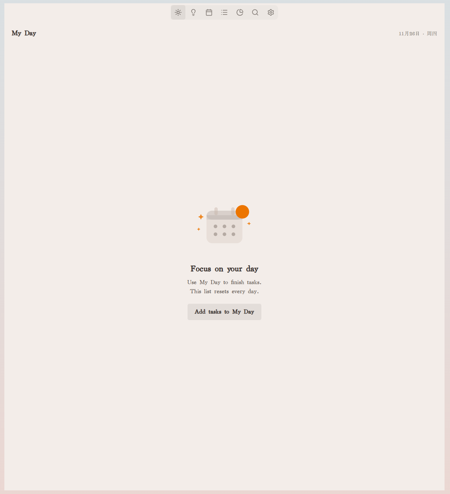
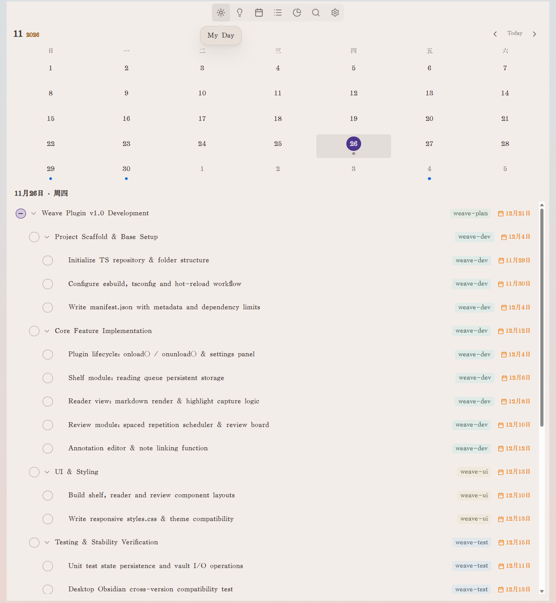
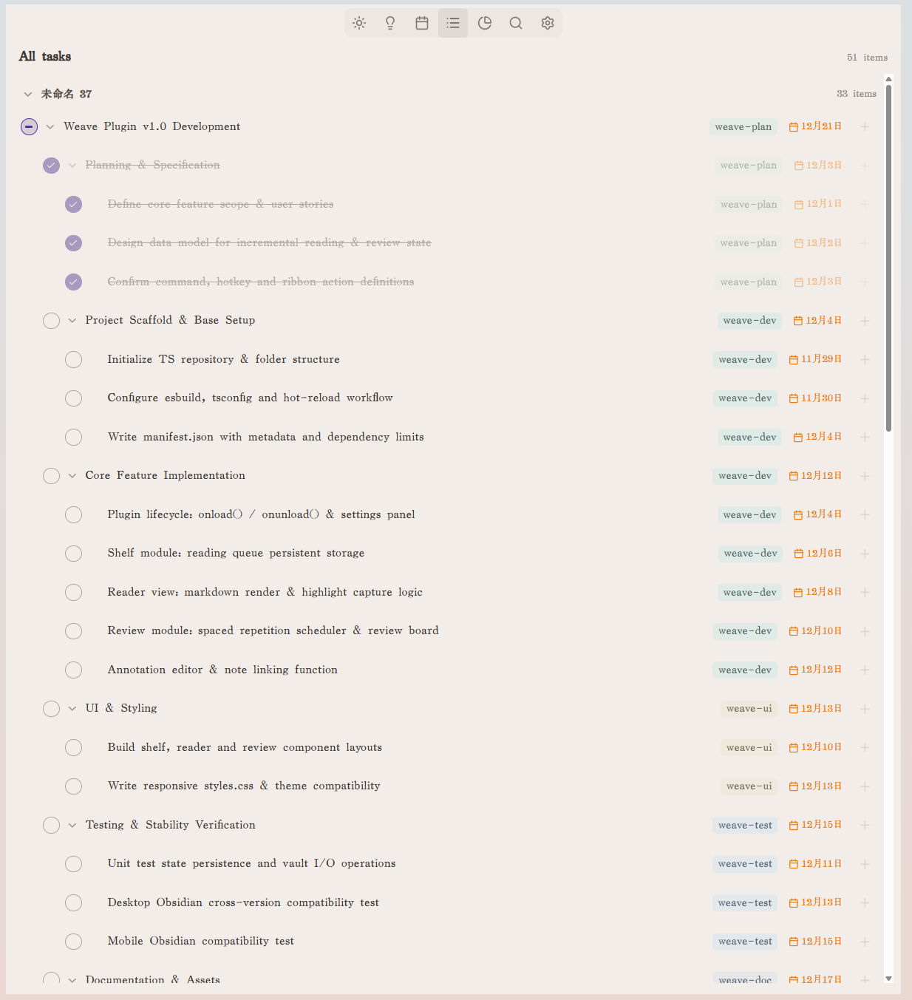
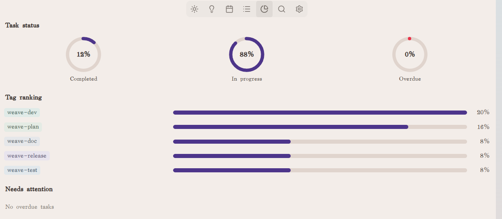

# TODO

A sidebar task manager for Obsidian with a native, minimal look. It does **not** keep a separate task database: Markdown notes remain the single source of truth. The plugin only scans checkbox tasks in your vault, offers light orchestration, and writes completion back to the notes.

Interaction and information architecture are inspired by [Microsoft To Do](https://todo.microsoft.com/) (My Day, Suggestions, day-focused browsing)—adapted for a narrow sidebar and note-first workflows. This is about product rhythm and layering, not a pixel clone of wide-screen card UI.

- Plugin id: `todo`
- Display name: `TODO`
- Version: see [`manifest.json`](./manifest.json)
- Compatible with common [Tasks](https://github.com/obsidian-tasks-group/obsidian-tasks) emoji markers
- Min Obsidian: `1.8.7`
- Standalone product (not bundled with Weave)

<p align="center">
  
</p>

<p align="center">
  
  &nbsp;
  
</p>

<p align="center">
  
</p>

| Screenshot | View |
|------------|------|
| Top | **My Day** empty state — daily focus list that resets each day |
| Middle left | **Day** workspace — calendar + nested tasks for the selected date |
| Middle right | **Tasks** — vault-wide list with colored tag capsules and parent/child nesting |
| Bottom | **Stats** — status share, tag ranking, needs attention |

[中文说明](#todo-中文)

---

## Open the sidebar

- Ribbon: check-square icon
- Command palette: **Open sidebar**
- View type: `todo-sidebar` (pin to left or right sidebar)

Toolbar (left → right, roughly):

| Control | Role |
|---------|------|
| My Day | Hand-picked focus list for today |
| Suggested | Smart push (overdue / due today / due soon) |
| Day | Month calendar + tasks for the selected day |
| Tasks | All vault tasks (can be hidden) |
| Stats | Status / tags / overdue attention (can be hidden) |
| Search | Expand search (supports field prefixes) |
| More | Calendar density, grouping, tab visibility, etc. |

The last tab is remembered. The My Day list refreshes on each calendar day.

---

## Five views

### 1. My Day

- **Hand-picked focus list**: add from Suggested (and similar) with `+` — not an auto dump of the whole vault.
- Stored in plugin data (`myDayIds` + `myDayDate`); **clears across days** so you pick again each morning.
- Items can be removed; empty state includes guidance and an add entry.
- Complements due dates in notes: “only these few things today.”

### 2. Suggested

The system pushes; you scan and check. Tasks already in My Day are excluded by default.

| Bucket | Rule |
|--------|------|
| Overdue | Incomplete with due date before today; further time buckets (earlier this week / last week / past month / earlier / older than a year) |
| Due today | `📅` equals today |
| Due soon | Due within about the next 3 days |

Row `+`: add to My Day and leave Suggested. Click the title to open the note and jump to the line.

### 3. Day

A date-driven workspace — not a variant of Suggested.

| Area | Role |
|------|------|
| Search | Same fielded search as global search; narrows the day list |
| Calendar | Pick a day; full month / two rows / one row density |
| Task list | Incomplete tasks **due / scheduled / created** that day; optional group by document |
| Daily note | Bridge from “see tasks” to “write the day” |

Calendar markers (incomplete tasks) distinguish overdue days, due days, created days, and similar load cues.

### 4. Tasks

Vault-wide browsing (tab can be turned off in **More**).

**Grouping** (sidebar More / related settings):

| Mode | Behavior |
|------|----------|
| Flat | Forest layout (parent/child indent kept) |
| By document | Group header: fold + short name without `.md` + count; hover for full path; **no** repeated filename on every row |
| By tag | Group headers as **colored capsules** (below); untagged in its own group |

Optional: hide completed tasks.

### 5. Stats

Read-only load view (tab can be hidden). With search open, aggregates run on the filtered set.

| Block | Content |
|-------|---------|
| Task status | Completed / in progress / overdue shares (rings) |
| Tag ranking | Top tags with the same colored capsules |
| Needs attention | Overdue list; click to open the note |

---

## Task row & interactions

Single-line layout on a quiet gray base:

`[checkbox] [twist?] title [tag capsules?] [weak date meta] [attachment?] [+ / actions]`

| Capability | Detail |
|------------|--------|
| Open | Click title → open source note and locate the line (brief highlight) |
| Complete | Checkbox writes back to the note; optional parent–child linking (settings) |
| Attachments | `![[image]]` / `` stripped from the title; icon only; hover preview |
| Tag capsules | Same Morandi palette as group headers; UI hides `#`; hover shows full `#tag` |
| Issue-style | Path names like “待解决问题” / bugs / issues, or tags `#bug` `#issue` `#问题` `#缺陷` → faint warning mark |
| `+` | Quiet by default; stronger on row hover. In Tasks: add subtask. In Suggested: add to My Day |
| My Day | Remove from My Day in supported views |

---

## Parent / child nesting

Parent/child trees come from Markdown **indent** within one file (max 5 levels; ~24px per level, aligned to the checkbox).

| Behavior | Detail |
|----------|--------|
| Collapse | Twist only when children exist; animated; remembered in the session |
| Add subtask | Row `+` → title prompt → indented line under the parent, then open/edit |
| Check linking (default on) | Check parent → all children; uncheck parent → clear children; all children checked → parent on; partial → indeterminate |
| Independent mode | Turn off “Link parent–child checkboxes” in settings |
| Guide lines | Optional faint dashed guides; off by default |

**Distinction:** tag group headers are containers (no checkbox). Parents and children are both tasks (with checkboxes); indent shows hierarchy.

---

## Colored tag capsules

- Stable color from a hash of the tag text (same tag → same color)
- ~8 soft Morandi colors; separate light / dark palettes (tint background + deeper text)
- Color stays **inside** the capsule; task text, checkboxes, dates, and row hover stay grayscale
- Untagged uses a neutral gray capsule
- Used on: tag group headers, row tags, Stats tag ranking

---

## Search

Toolbar search expands a panel. Plain text plus field prefixes (a bare `due:` while typing does not become a text needle).

| Prefix | Examples | Meaning |
|--------|----------|---------|
| `due:` | `due:today` / `due:tomorrow` / `due:overdue` / `due:thisweek` / `due:2026-11-26` | Due date |
| `scheduled:` | same style | Scheduled date |
| `tag:` | `tag:work` | Tag (`#` optional) |
| `folder:` | `folder:Projects` | Path prefix folder |
| `path:` | `path:weekly` | Path substring |
| `priority:` | `priority:high` | Priority enum |

Free text also filters title / path / tags. Search scopes the current list and Stats aggregates.

---

## Note syntax (Tasks-compatible)

```markdown
- [ ] Task title 📅 2026-11-26 ⏳ 2026-11-25 ➕ 2026-11-20 #tag 🔺
	- [ ] Subtask
- [x] Done ✅ 2026-11-26
```

| Marker | Meaning |
|--------|---------|
| `📅` | Due |
| `⏳` | Scheduled |
| `➕` | Created |
| `✅` | Done date |
| `🔁` | Recurring (hint in UI) |
| `🔺⏫🔼🔽⏬` | Priority (highest → lowest) |
| `#tag` | Tag |
| `![[image.png]]` / `` | Attachment (not inlined as raw markdown in the list) |

Indent defines parent/child (spaces or tabs; tab ≈ 2 spaces wide).

---

## Settings

**Settings → TODO**

| Setting | Detail |
|---------|--------|
| Language | Follow Obsidian, or fix: zh-CN / zh-TW / English / 日本語 / 한국어 / Русский / Español |
| Link parent–child checkboxes | Default on |
| Show nest guide lines | Default off |
| Excluded folders | Skip templates, etc.; search-to-add; blocks duplicates and covered subfolders |

Sidebar **More** also toggles calendar density, group-by-document, Stats/Tasks tab visibility, list grouping, hide completed, and related options.

---

## Data & sync

| Data | Where |
|------|--------|
| Settings, My Day, last tab | Plugin `loadData` / `saveData` |
| Task text & checkbox state | **Note Markdown** (source of truth) |
| Task index | In-memory; incremental on create / modify / delete / rename |

Changing excluded folders triggers a notice and a rescan.

---

## Install

### BRAT / Release

Download `main.js`, `manifest.json`, and `styles.css` from [Releases](https://github.com/zhuzhige123/obsidian-todo/releases) into:

`<vault>/.obsidian/plugins/todo/`

Enable **TODO** under Community plugins.

### Build from source

```bash
npm install
npm run build
```

Copy root `main.js`, `manifest.json`, and `styles.css` into the plugin folder above.

### Develop

```bash
npm install
npm run dev
```

`dev` builds and syncs into configured Obsidian test vaults; `styles.css` changes sync too (Hot Reload or toggle the plugin).

```bash
npm test
npm run verify:obsidian-community
```

---

## Design principles

### Inspired by Microsoft To Do

| Borrowed | In this plugin |
|----------|----------------|
| My Day | Hand-picked, clears daily, never auto-fills |
| Suggestions / smart lists | Overdue → today → soon push queue (not another calendar) |
| Day browsing | Day workspace: calendar + that day’s tasks (+ search / daily note) |
| Scannable rows | Checkbox + title first; demote source and secondary meta |
| Empty guidance | My Day empty state with focus copy and add entry |

Not copied: wide multi-pane layouts, stacked white cards, Outlook-deep planning. In a sidebar, prefer gray hierarchy and Tasks note syntax.

### Other principles

1. **Sidebar-sized, not a mini dashboard** — tabs can hide; density stays restrained.
2. **Suggested = push; Day = by date; My Day = hand-picked** — three “today” meanings, not three duplicate lists.
3. **Hierarchy via whitespace, gray, weight**; color only accents tags.
4. **Tasks-compatible syntax** without forcing a migration.
5. **Compliance**: vault / plugin data only; no private Node APIs; CSS aimed at community review.

---

## Repository

- GitHub: https://github.com/zhuzhige123/obsidian-todo  
- Author: https://github.com/zhuzhige123  

---
---

# TODO（中文）

这是一款贴合 Obsidian 原生极简风格的侧边栏任务管理插件，不维护独立任务数据库，以 Markdown 笔记为唯一真实数据源，仅负责扫描汇总库内勾选任务、提供轻量编排与回写能力；交互与信息架构参考 [微软 To Do](https://todo.microsoft.com/) 的分层节奏，在窄侧栏中提供「我的一天」手动挑选专注任务、系统推送建议、按日日历工作台、全库浏览与负荷查看能力，只借鉴产品逻辑而非像素复刻宽屏卡片样式，让任务始终锚定在你的笔记原文之上。

- 插件 id：`todo`
- 显示名：`TODO`
- 当前版本：见 [`manifest.json`](./manifest.json)
- 兼容：[Tasks](https://github.com/obsidian-tasks-group/obsidian-tasks) 常用 emoji 语法
- 最低 Obsidian：`1.8.7`
- 独立产品（非 Weave 主插件捆绑）

<p align="center">
  
</p>

<p align="center">
  
  &nbsp;
  
</p>

<p align="center">
  
</p>

| 插图 | 界面 |
|------|------|
| 上 | **我的一天** 空态 — 每日刷新的手选专注列表 |
| 中左 | **日工作台** — 月历 + 当日嵌套任务 |
| 中右 | **任务列表** — 全库列表、多彩标签胶囊与父子嵌套 |
| 下 | **统计** — 状态占比、标签排行、需要关注 |

[Back to English](#todo)

---

## 打开方式

- 左侧功能区（Ribbon）方框勾选图标
- 命令面板：`打开侧边栏` / `Open sidebar`
- 视图类型：`todo-sidebar`（可钉在左右侧栏）

顶部工具栏（从左到右，大致）：

| 控件 | 作用 |
|------|------|
| 我的一天 | 今日手选专注列表 |
| 建议 | 智能推送（逾期 / 今日 / 即将到期） |
| 日工作台 | 月历 + 按日任务 |
| 任务列表 | 全库任务（可隐藏） |
| 统计 | 状态 / 标签 / 逾期关注（可隐藏） |
| 搜索 | 展开搜索条（支持字段前缀） |
| 更多 | 日历密度、分组、页签显隐等 |

上次打开的页签会记住；「我的一天」列表按自然日刷新。

---

## 五个界面

### 1. 我的一天（My Day）

- **手选专注清单**：从「建议」等处用 `+` 加入；不是全库自动塞满。
- 数据存在插件 `data.json`（`myDayIds` + `myDayDate`），**跨日自动清空**，每天重新挑。
- 可从列表移出；空态有引导文案与入口。
- 适合「今天只盯这几件」，与笔记里的 due 日期互补。

### 2. 建议（Suggested）

系统推送、你负责扫与勾。默认不含已在「我的一天」里的任务。

| 分组 | 规则 |
|------|------|
| 逾期 | 未完成且截止日期早于今天；再按时间桶细分（本周更早 / 上周 / 近月 / 更早 / 一年以上） |
| 今日截止 | `📅` 等于今天 |
| 即将截止 | 未来约 3 天内到期 |

行上 `+`：加入我的一天，并离开建议列表。点击标题打开笔记并定位到该行。

### 3. 日工作台（Day）

日期驱动的工作台，不是建议页的变体。

| 区域 | 作用 |
|------|------|
| 搜索 | 与全局搜索同一套语法，可缩小当日列表 |
| 日历 | 选日；完整月历 / 双行 / 单行三种密度 |
| 任务列表 | 该日 **截止 / 安排 / 创建** 的未完成任务；可按文档分组 |
| 日记 | 与「看任务 → 写当天」衔接 |

日历点标记用于区分逾期日、有 due、有创建日等负荷。

### 4. 任务列表（Tasks）

全库任务浏览（可在「更多」关闭页签）。

| 模式 | 表现 |
|------|------|
| 不分组 | 扁平森林（仍保留父子缩进） |
| 按文档 | 分组头：折叠 + 去 `.md` 短名 + 数量；hover 看完整路径；组内不再重复文件名 |
| 按标签 | 分组头为**多彩胶囊**；无标签单独一组 |

还可选择隐藏已完成任务。

### 5. 统计（Stats）

只读负荷视图（可关闭页签）；搜索开启时先按搜索结果再聚合。

| 区块 | 内容 |
|------|------|
| 任务状态 | 已完成 / 进行中 / 逾期占比（环形图） |
| 标签排行 | Top 标签；左侧同款多彩胶囊 |
| 需要关注 | 逾期任务列表，可点进笔记 |

---

## 任务行与交互

统一单行：`[复选框] [折叠箭头?] 标题 [多彩标签胶囊?] [日期等弱元信息] [附图?] [+ / 操作]`

| 能力 | 说明 |
|------|------|
| 打开 | 点击标题 → 打开源笔记并定位（短暂高亮） |
| 完成 | 勾选回写笔记；可与父子联动 |
| 附图 | 剥离 `![[…]]` / ``，只留图标；hover 预览 |
| 标签胶囊 | 莫兰迪色板；界面隐藏 `#`，hover 看完整标签 |
| 问题项 | 路径或 `#bug` / `#issue` / `#问题` / `#缺陷` → 浅灰警示 |
| `+` | 默认低对比；列表新增子任务，建议加入我的一天 |

---

## 父子嵌套任务

由 Markdown **缩进**解析同一文件内父子树（最多 5 层；每层约 24px）。

| 行为 | 说明 |
|------|------|
| 折叠 | 仅有子任务时显示箭头；会话内记忆 |
| 新增子任务 | 行上 `+` → 输入标题 → 写入缩进行 |
| 勾选联动（默认开） | 父级联子；子回写父（含半选） |
| 独立模式 | 设置中关闭联动 |
| 引导线 | 可选虚线；默认关 |

标签分组头是分类容器（无复选框）；父/子都是任务，靠缩进表达从属。

---

## 多彩标签胶囊

- 标签文本哈希定色（同标签同色）
- 约 8 色低饱和莫兰迪；亮/暗主题各一套
- 颜色只在胶囊内；任务主体保持灰度
- 用于分组头、行内标签、统计标签排行

---

## 搜索

| 前缀 | 示例 | 含义 |
|------|------|------|
| `due:` | `due:today` / `due:overdue` / `due:2026-11-26` | 截止日期 |
| `scheduled:` | 同上风格 | 安排日期 |
| `tag:` | `tag:工作` | 标签 |
| `folder:` | `folder:Projects` | 文件夹前缀 |
| `path:` | `path:weekly` | 路径子串 |
| `priority:` | `priority:high` | 优先级 |

未写完的 `due:` 不会误当成关键词。可与自由文本组合。

---

## 笔记语法（Tasks 兼容）

```markdown
- [ ] 任务标题 📅 2026-11-26 ⏳ 2026-11-25 ➕ 2026-11-20 #标签 🔺
	- [ ] 子任务
- [x] 已完成 ✅ 2026-11-26
```

支持 `📅⏳➕✅🔁`、优先级 emoji、`#tag`、图片嵌入；缩进决定父子。

---

## 设置

**设置 → TODO**：界面语言、父子勾选联动、嵌套引导线、排除文件夹。  
侧栏「更多」还可切换日历密度、分组、页签显隐、隐藏已完成等。

---

## 数据与同步行为

| 内容 | 位置 |
|------|------|
| 设置、我的一天、上次页签 | 插件 `loadData` / `saveData` |
| 任务正文与勾选 | **笔记 Markdown**（真源） |
| 任务索引 | 内存；监听增删改重命名增量刷新 |

---

## 安装

### BRAT / Release

从 [Releases](https://github.com/zhuzhige123/obsidian-todo/releases) 下载 `main.js`、`manifest.json`、`styles.css` 到：

`<vault>/.obsidian/plugins/todo/`

启用 **TODO**。

### 从源码 / 开发

```bash
npm install
npm run build   # 或 npm run dev
npm test
npm run verify:obsidian-community
```

---

## 设计原则（产品）

### 参考 Microsoft To Do

| 借鉴 | 落点 |
|------|------|
| My Day | 手选、跨日清空、不自动塞满 |
| 建议 / 智能列表 | 逾期 → 今日 → 即将到期推送队列 |
| 按日浏览 | 日工作台：日历 + 当日任务 |
| 单行可扫 | 复选框 + 标题为主 |
| 空态引导 | 我的一天专注文案与添加入口 |

不照搬宽屏多栏、白卡片堆叠与 Outlook 深度规划；侧栏优先灰度层级与 Tasks 语法。

### 其它原则

1. 侧栏够用、不做迷你仪表盘  
2. 建议 = 推送；日工作台 = 按日；我的一天 = 手选  
3. 留白 / 灰度 / 字重建层级；彩色只点缀标签  
4. 兼容 Tasks，不强制迁移  
5. 数据走 vault / 插件 data；合规社区审查习惯  

---

## 仓库

- GitHub：https://github.com/zhuzhige123/obsidian-todo  
- Author：https://github.com/zhuzhige123  
